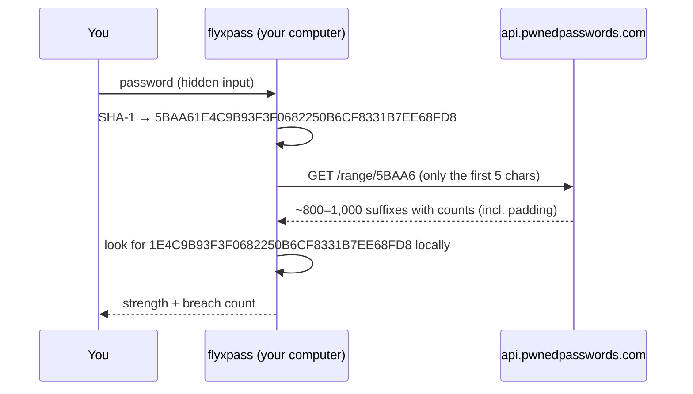

# flyxpass

[](https://github.com/Butt3rFLYX/flyxpass/actions/workflows/ci.yml)


[](LICENSE)

**Rate how strong a password is and check whether it has appeared in a known
data breach without the password ever leaving your computer.**

`flyxpass` is a small command-line tool written in pure Python (standard
library only). It estimates a password's entropy and looks it up in
[Have I Been Pwned](https://haveibeenpwned.com/Passwords) using the
*k-anonymity* range API: only the first 5 characters of the password's SHA-1
hash are sent over the network.

## Features

- **Hidden input:** the password is typed at a prompt with no echo. It is never
  accepted as an argument, so it can't end up in your shell history or the
  process list.
- **Entropy estimate:** detects the character pool (lowercase, uppercase,
  digits, special) and computes `length × log2(pool size)`.
- **Rating:** weak / medium / strong, plus an overall verdict.
- **Breach check with k-anonymity:** SHA-1 is computed locally, only the 5-char
  prefix is sent, and the remaining 35 chars are compared locally.
- **Response padding:** the `Add-Padding` header hides the real number of
  matches from anyone watching the encrypted traffic.
- **Robust networking:** configurable timeout, automatic retries with back-off
  for timeouts, connection errors and HTTP 429/5xx, plus clear error messages.
- **Nothing is stored:** the password and its full hash are never printed,
  logged or written to disk.
- **Script-friendly:** meaningful exit codes and a `--stdin` mode for piping
  from a password manager.

## Quick start

```bash
git clone https://github.com/Butt3rFLYX/flyxpass.git
cd flyxpass
python -m flyxpass
```

Or install it as a command:

```bash
pipx install git+https://github.com/Butt3rFLYX/flyxpass.git
# or, inside the cloned folder:
python -m pip install .

flyxpass
```

Requires Python 3.10 or newer. There are no third-party dependencies.

## Example

A password that is in breach lists:

```text
$ flyxpass
Password (input hidden):
Length:      8 characters
Characters:  lowercase (pool size 26)
Entropy:     37.6 bits  = 8 x log2(26)
Strength:    weak
Checking Have I Been Pwned (k-anonymity) ...
Breaches:    FOUND 52,372,427 times in known data breaches
Verdict:     UNSAFE - this password is public. Do not use it anywhere, change it where you do.
```

A long random passphrase:

```text
$ flyxpass
Password (input hidden):
Length:      28 characters
Characters:  lowercase, uppercase, digits, special (pool size 95)
Entropy:     184.0 bits  = 28 x log2(95)
Strength:    strong
Checking Have I Been Pwned (k-anonymity) ...
Breaches:    not found in known data breaches
Verdict:     strong - good
```

(Breach counts change as Have I Been Pwned adds new data.)

## Usage

```text
flyxpass [--offline] [--stdin] [--timeout SECONDS] [--retries N] [-V]
```

| Option              | Meaning                                                         |
| ------------------- | --------------------------------------------------------------- |
| `--offline`         | Only rate the strength and skip the online breach check.        |
| `--stdin`           | Read the password from standard input instead of prompting.     |
| `--timeout SECONDS` | Network timeout per attempt (default `10`).                     |
| `--retries N`       | Extra attempts after a timeout or network error (default `2`).  |
| `-V`, `--version`   | Print the version.                                              |

### Exit codes

| Code  | Meaning                                                    |
| ----- | ---------------------------------------------------------- |
| `0`   | Not found in breaches (or `--offline`)                     |
| `1`   | **Found** in known data breaches                           |
| `2`   | Usage error or empty input                                 |
| `3`   | Breach check failed (network error, timeout, ...)          |
| `130` | Interrupted with Ctrl+C                                    |

### Piping from a password manager

```bash
pass show email/work | flyxpass --stdin    # only the first line is read
```

Don't write `echo 'my password' | flyxpass --stdin`: the `echo` line itself
would be saved in your shell history. Use the interactive prompt instead.

## How it works

### 1. Strength: entropy from the character pool

Each character class found in the password adds to the pool an attacker would
have to search:

| Class     | Characters                                | Pool size |
| --------- | ----------------------------------------- | --------: |
| lowercase | `a-z`                                     |        26 |
| uppercase | `A-Z`                                     |        26 |
| digits    | `0-9`                                     |        10 |
| special   | ASCII punctuation, space, any other char  |        33 |

```text
entropy = length × log2(pool size)
```

| Entropy      | Rating     | Example of a *random* password with this entropy |
| ------------ | ---------- | ------------------------------------------------ |
| < 50 bits    | **weak**   | 8 lowercase letters (37.6 bits)                  |
| 50–79 bits   | **medium** | 10 chars from all four classes (65.7 bits)       |
| ≥ 80 bits    | **strong** | 13 chars from all four classes (85.4 bits)       |

> **Limitation:** this formula assumes every character was chosen at random,
> so it is an *upper bound*. `Summer2024!` scores 72.3 bits ("medium") even
> though it follows a very common pattern. This is exactly why the breach check
> matters: a password found in a breach is reported as **UNSAFE** regardless
> of its entropy.

### 2. Breach check: k-anonymity



1. The password is hashed locally with SHA-1 (the format the Pwned Passwords
   database uses).
2. Only the **first 5 hex characters** (the prefix) are sent to
   `https://api.pwnedpasswords.com/range/<prefix>`.
3. The server answers with every hash suffix in its database that starts with
   this prefix, together with how often each was seen. Hundreds of real
   passwords share each prefix, so the server can't tell which one you're
   checking.
4. flyxpass compares the remaining 35 characters **locally** and prints the
   count if there is a match.

With `Add-Padding: true` the server also mixes in fake entries with a count of
0, so the size of the encrypted response doesn't give anything away.

## Security notes

- The password is read with `getpass` (no echo) and is never accepted on the
  command line. If you pass an argument anyway, flyxpass refuses it *without*
  printing it back.
- Neither the password nor its full hash is printed, logged or saved. Error
  messages contain only network details.
- Python can't reliably wipe a string from memory. flyxpass drops its
  reference as soon as the check is done and keeps nothing in files.
- HTTPS certificates are verified, and only a validated 5-character hex prefix
  can ever be put into the request URL.
- The server still sees the prefix, your IP address and the time of the
  request. That's the trade-off of k-anonymity.
- "Not found" doesn't mean a password is safe. It only means it isn't in
  the public breach corpus. Use a password manager and unique passwords.

## Project structure

```text
flyxpass/
├── flyxpass/
│   ├── cli.py         # argument parsing, hidden input, output, exit codes
│   ├── strength.py    # character pools, entropy, rating
│   ├── pwned.py       # SHA-1, k-anonymity request, retries, response parsing
│   └── __main__.py    # enables `python -m flyxpass`
├── tests/             # pytest suite (network fully mocked)
├── .github/workflows/ci.yml
└── pyproject.toml
```

## Development

```bash
python -m pip install pytest ruff

python -m pytest                     # unit tests, no network needed
ruff check . && ruff format --check .

# optional: test against the real API (sends only the prefix 5BAA6
# for "password" and the prefix of a random token)
FLYXPASS_LIVE_TESTS=1 python -m pytest -m live
```

CI runs the tests on Python 3.10–3.14 (Linux) and on Windows and macOS.

## Requirements covered (German)

| Aufgabe                                              | Umsetzung                                                    |
| ---------------------------------------------------- | ------------------------------------------------------------ |
| Passwort verdeckt einlesen, nicht in der Shell-History | `getpass`, kein Passwort-Argument (`cli.py`)               |
| Entropie: Zeichenpool × Länge                        | `strength.assess()`: Länge × log2(Poolgröße)                 |
| Einstufung (schwach, mittel, stark)                  | `weak` / `medium` / `strong` + Gesamturteil                  |
| SHA-1 lokal berechnen                                | `pwned.sha1_hex()`                                           |
| Nur die ersten 5 Zeichen senden (k-Anonymity)        | `pwned.fetch_range()` prüft das Präfix vor dem Senden        |
| Suffix lokal vergleichen                             | `pwned.count_in_range()`                                     |
| Trefferanzahl ausgeben                               | `Breaches: FOUND n times`, Exit-Code 1                       |
| Netzwerkfehler und Timeouts behandeln                | `--timeout`, `--retries`, Back-off, Exit-Code 3              |
| Passwort nicht loggen oder speichern                 | keine Ausgabe, kein Logging, keine Dateien (per Test geprüft) |

## Acknowledgements

Breach data comes from Troy Hunt's
[Have I Been Pwned](https://haveibeenpwned.com/) Pwned Passwords service.

## License

[MIT](LICENSE)
